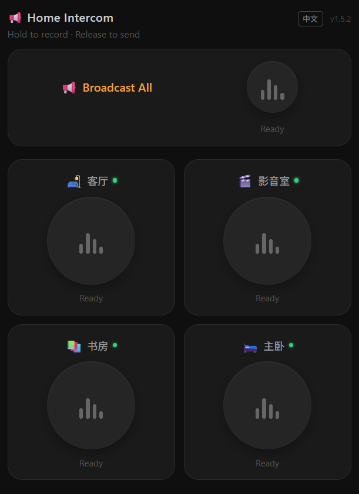

# Домашний интерком (Home Intercom)

[English](README.md) · [中文](README.zh-CN.md) · Русский

[](https://github.com/mdj2812/home-intercom/pkgs/container/home-intercom)

PWA с нажатием для разговора → Home Assistant → умные колонки. Удерживайте кнопку, скажите что-нибудь — фраза прозвучит на колонках.

ffmpeg не нужен: запись в браузере и преобразование PCM→WAV на чистом Python держат образ Docker на 131 МБ.



## Как это устроено

```
Телефон PWA → Flask :8764 → Home Assistant API → колонки
                ↕
        /data/rooms.json (управляется из PWA)

    ── или ──

Телефон PWA → интеграция HA → Home Assistant API → колонки
                ↕
        Настройки PWA → Комнаты
```

Два способа развёртывания:

- **Интеграция HA (рекомендуется)** — работает внутри Home Assistant, отдельный контейнер не нужен
- **Docker** — отдельный сервер Flask (прежний способ, по-прежнему полностью поддерживается)

Автоостановка подстраивается под возможности колонок:

1. **Плееры Music Assistant** — родной `play_announcement` (быстрее и надёжнее всего)
2. **Современные плееры** — `play_media(announce=True)` с `repeat=off` (HomePod/Chromecast)
3. **Простые плееры** — пауза по таймеру после воспроизведения (переменная `PAUSE_BUFFER`)

## Рекомендация: плееры Music Assistant

Если колонки подключены через [Music Assistant](https://music-assistant.io/), **лучше использовать** объекты `media_player`, которые создаёт интеграция MA, а не родные объекты колонок.

Плееры MA поддерживают службу `play_announcement` — воспроизведение останавливается само. **Пауза по таймеру не нужна** (настройка `PAUSE_BUFFER` не требуется). Надёжнее и с меньшей задержкой.

## Установка (интеграция HA через HACS)

[](https://my.home-assistant.io/redirect/hacs_repository/?owner=mdj2812&repository=home-intercom&category=integration)

1. Добавьте этот репозиторий как пользовательский в HACS
2. Установите «Home Intercom» из HACS
3. Откройте **Настройки → Устройства и службы → Добавить интеграцию** и найдите «Home Intercom»
4. Подтвердите установку — запись создаётся без комнат. Откройте PWA (**⚙ → Комнаты**) и добавьте колонки.

Блок `home_intercom:` в `configuration.yaml` устарел. При запуске оставшиеся комнаты из YAML один раз импортируются в записываемую запись, а запись конфигурации YAML удаляется. После этого уберите блок YAML и управляйте комнатами в PWA.

5. **Добавьте на боковую панель** (HA требует дефис `-` в URL панели и карточки «Веб-страница»):

   **Вариант A — прямая ссылка на панель (проще всего):** откройте или сохраните `https://<ваш-ha>/home-intercom`

   **Вариант B — панель на боковой панели:**
   1. **Настройки → Панели → Добавить панель** — путь URL: `home-intercom`, включите **Показывать на боковой панели**
   2. Откройте панель → **Добавить карточку → Веб-страница** — URL: `/home-intercom`
   3. Сохраните — пункт на боковой панели открывает PWA интеркома

   Старый путь `/home_intercom` по-прежнему открывается напрямую в браузере, но HA не примет его для боковой панели и карточек «Веб-страница».

### Загрузка звука с аутентификацией

Аппаратные клиенты могут отправлять звук через обычную аутентификацию Home Assistant:

```http
POST /api/home_intercom/record?target=living
Authorization: Bearer <HA_LO...KEN>
Content-Type: audio/wav
```

Создайте долгоживущий токен доступа в профиле пользователя Home Assistant и отправляйте его по HTTPS.
Если заголовок `Authorization` есть, запрос проходит через стандартный механизм токенов HA;
без него эндпоинт использует X-PWA-Token встроенного PWA.

### Аппаратный компаньон: intercom-button

Физическая кнопка «нажми и говори» для стола — телефон не нужен.

[intercom-button](https://github.com/mdj2812/intercom-button) — прошивка ESP32-S3, которая подключает микрофон MAX9814 и кнопку к Home Intercom по Wi-Fi. Нажали, сказали, отпустили — голос звучит в выбранной комнате.

> **Стадия:** Home Intercom и intercom-button активно разрабатываются. Железо кнопки сейчас демонстрационный прототип; дальше возможна форма **умной ручки** (энкодер + нажатие для разговора + громкость + дисплей).

### Сообщество

- [Сообщество HA (English)](https://community.home-assistant.io/t/home-intercom-push-to-talk-pwa-for-any-smart-speaker-via-home-assistant/1016027)
- [Hassbian (中文)](https://bbs.hassbian.com/thread-32686-1-1.html)
- [Hassbian — железо intercom-button (中文)](https://bbs.hassbian.com/thread-32765-1-1.html)

## Установка (Docker)

```bash
git clone https://github.com/mdj2812/home-intercom.git
cd home-intercom

# Готовый образ с ghcr.io
export IMAGE=ghcr.io/mdj2812/home-intercom:latest
docker compose -f docker/docker-compose.example.yml up -d

# Или собрать локально
docker build -f docker/Dockerfile -t home-intercom:latest .
```

Образы собирает и публикует в ghcr.io GitHub Actions. Обновление:

```bash
git pull
docker compose -f docker/docker-compose.example.yml pull
docker compose -f docker/docker-compose.example.yml up -d
```

### Настройка Docker

#### Переменные окружения

| Переменная | Описание |
|------------|----------|
| `HA_URL` | Адрес Home Assistant, например `http://192.168.1.10:8123` |
| `HA_TOKEN` | Долгоживущий токен доступа HA |
| `PUBLIC_URL` | (Необязательно) Домен обратного прокси, с которого HA забирает звук |
| `AUDIO_DIR` | Каталог для звука, по умолчанию `/data/audio` |
| `PAUSE_BUFFER` | (Необязательно) Дополнительные секунды до автопаузы, по умолчанию `0` |
| `STATE_TIMEOUT` | (Необязательно) Сколько секунд ждать состояние объекта, по умолчанию `5` (увеличьте для Bluetooth и MA) |
| `TRUSTED_PROXY` | (Необязательно) IP обратного прокси, по умолчанию `*` (любой) |

#### Комнаты (PWA)

Комнаты добавляются, изменяются и удаляются в PWA: **⚙ → Комнаты**. Рабочая конфигурация лежит в `/data/rooms.json` на томе `./data` из compose (пустой, пока вы не добавите комнаты). Не монтируйте файл `rooms.json`.

У каждой комнаты есть `name`, колонка `entity` (entity_id `media_player` в HA) и необязательные `announce_volume` (0–100, только Music Assistant) и `pause_buffer`.

## Вступительный сигнал

Когда вы нажимаете кнопку интеркома, перед объявлением звучит дверной сигнал.

### Свой сигнал (настройки PWA)

Нажмите **⚙** в шапке PWA и откройте **Настройки → Свой сигнал**:

| Действие | Что делает |
|----------|------------|
| **▶ Прослушать** | Проигрывает текущий сигнал (встроенный или свой) |
| **Заменить сигнал** | Загружает WAV или MP3 (не дольше 10 секунд). MP3 в браузере превращается в моно WAV 16 кГц. |
| **Вернуть по умолчанию** | Удаляет загруженный файл и возвращает встроенный сигнал |

Свой сигнал сохраняется между перезапусками (интеграция HA кладёт его в свой звуковой каталог; Docker — в `AUDIO_DIR`, по умолчанию `/data/audio`). В обоих режимах это работает одинаково.

### Как он воспроизводится

- **Плееры MA** — если задан свой сигнал, он передаётся через `pre_announce_url`; иначе используется встроенный pre-announce Music Assistant
- **Обычные плееры** — сигнал дописывается в начало WAV (без паузы и шва)

### Дополнительно: заменить файл вручную

Встроенный сигнал — `pre_announce.wav` (16 кГц, моно, 16 бит). Его всё ещё можно заменить напрямую:

- **Интеграция HA:** `custom_components/home_intercom/static/pre_announce.wav` (перезапустите HA)
- **Docker:** пересоберите образ или смонтируйте файл поверх `/app/static/pre_announce.wav`

Загрузка через PWA предпочтительнее: перезапуск не нужен, и она действует и для плееров MA.

## HTTPS

Запись в PWA требует HTTPS. Для Docker удобен обратный прокси Caddy.

```Caddyfile
broadcast.your-domain.com {
    reverse_proxy 127.0.0.1:8764
}
```

У интеграции HA HTTPS обеспечивает обратный прокси Home Assistant.
